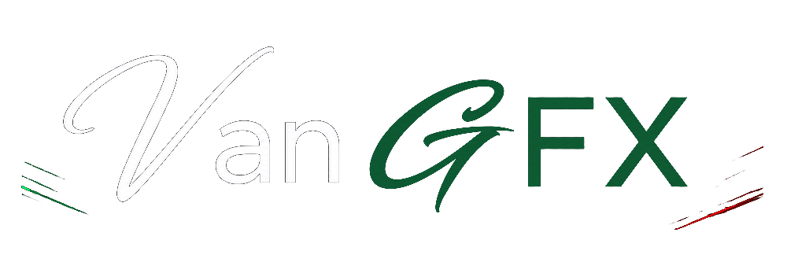

<div align="center">



<p><em>API Reference · Architecture Notes · Worked Examples</em></p>

<a href="#">

</a>

<br/>

[](LICENSE)
[](https://en.cppreference.com/w/cpp/20)
[](libs/)
[](https://www.teamvanilla.org/)

<br/>

[](#)
[](#)
[](#)
[](#)
[](#)
[](#)

</div>


<div align="center">

### 📑 Contents

[ContextBuilder](#-contextbuilder) · [Context](#-context) · [FrameContext](#-framecontext) · [ShaderBuilder](#-shaderbuilder)

[Effect API](#-effect-api) · [Uniforms](#-uniforms) · [CaptureSession](#-capturesession) · [GBufferCapture](#-gbuffercapture)

[D3D12 Extensions](#-d3d12-extensions) · [Event Structs](#-event-structs) · [Error Handling](#-error-handling)

[Handle Types](#-handle-types) · [Compat Layer](#-compat-layer)

</div>


## 🏗️ ContextBuilder

Fluent builder for constructing a `Context`. Call `.build()` exactly once at startup. The returned `Context` owns all vtable patches — they are removed cleanly when the object is destroyed.

```cpp
#include <vangfx/vangfx.hpp>

auto ctx = vangfx::ContextBuilder{}
    .backend(vangfx::BackendKind::Auto)       // Auto | D3D9 | D3D11 | D3D12
    .log_level(vangfx::LogLevel::Info)        // Off | Error | Warn | Info | Debug | Trace
    .log_callback([](vangfx::LogLevel lvl, std::string_view msg) { /* ... */ })
    .d3d9_device(ptr)                         // optional: supply existing IDirect3DDevice9*
    .d3d11_device(ptr)                        // optional: supply existing ID3D11Device*
    .d3d12_device(ptr)                        // optional: supply existing ID3D12Device*
    .d3d12_command_queue(ptr)                 // optional: supply direct ID3D12CommandQueue*
    .d3d12_min_shader_model(60)               // fail-fast if device is below SM 6.0
    .auto_capture(true)                       // begin CaptureSession on first Present
    .build();                                 // Result<unique_ptr<Context>>

if (!ctx) {
    printf("init failed: %s\n", ctx.error().message.c_str());
}
```

**`BackendKind::Auto` detection order:** D3D12 → D3D11 → D3D9 (first loaded DLL wins). Specify a backend explicitly to override.


## 🌐 Context

The root object returned by `ContextBuilder::build()`. Owns all vtable patches.

### Callback registration

```cpp
ctx->on_draw(fn);             // DrawCallback
ctx->on_render_target(fn);    // RenderTargetCallback
ctx->on_present(fn);          // PresentCallback
ctx->on_resource(fn);         // ResourceCallback
ctx->on_state_change(fn);     // StateCallback
ctx->on_query(fn);            // QueryCallback
ctx->on_device_lost(fn);      // void()
ctx->on_device_reset(fn);     // void(FrameContext&)

// D3D12 only
ctx->on_command_list(fn);     // CommandListCallback
ctx->on_pso_create(fn);       // PSOCreateCallback
ctx->on_resource_barrier(fn); // ResourceBarrierCallback
```

### Shader & effect management

```cpp
auto shader = ctx->compile_shader(builder);
auto effect = ctx->link_effect(vs, ps);
auto cs_eff = ctx->link_compute_effect(cs);
ctx->destroy(effect->handle);
ctx->destroy(shader->handle);
```

### Capture control

```cpp
ctx->start_capture();
ctx->stop_capture();
bool active = ctx->capture_active();
```

### Backend queries

```cpp
vangfx::BackendKind bk = ctx->backend();
uint32_t d9ver          = ctx->d3d9_ver();
uint32_t d11fl          = ctx->d3d11_feature_level();  // e.g. 0xB100 = FL 11.1
uint32_t d12sm          = ctx->d3d12_shader_model();   // e.g. 66 = SM 6.6
uint32_t d12rt          = ctx->d3d12_raytracing_tier();
uint32_t d12ms          = ctx->d3d12_mesh_shader_tier();
```


## 🖼️ FrameContext

Passed to every callback. Exposes per-frame state. **Never store across frames.**

```cpp
frame.backend();           // BackendKind
frame.frame_index();       // uint64_t — monotonic present counter
frame.surfaces();          // FrameSurfaces { width, height, back_buffer_format }
frame.pipeline();          // PipelineState snapshot
frame.format_of(rt);       // SurfaceFormat of a live RenderTargetHandle
frame.format_of(db);       // SurfaceFormat of a live DepthBufferHandle
frame.format_of(tex);      // SurfaceFormat of a live TextureHandle
frame.capture_active();    // bool
frame.latest_capture();    // Result<GBufferCapture>

// Resource creation
auto tex = frame.create_texture(desc);         // Result<TextureHandle>
auto rt  = frame.create_render_target(desc);   // Result<RenderTargetHandle>
auto db  = frame.create_depth_buffer(desc);    // Result<DepthBufferHandle>
frame.destroy(tex.value());
frame.destroy(rt.value());
frame.destroy(db.value());

// Effect binding
frame.bind_effect(effect_handle);
frame.unbind_effect();
frame.update_constant_buffer(cb, ptr, size);

// CPU readback
auto rb = frame.readback(rt_handle);  // Result<ReadbackResult>
// rb->pixels    — std::span<const uint8_t>
// rb->row_pitch — bytes per scanline (may include padding)
```


## 🔧 ShaderBuilder

Compiles HLSL or wraps pre-compiled bytecode. Routes to `d3dcompiler_47.dll` for D3D9/D3D11 or `dxcompiler.dll` + `dxil.dll` for D3D12 SM 6.x — both runtime-loaded, no static link required.

```cpp
// HLSL from string
auto s = vangfx::ShaderBuilder{}
    .source(hlsl_string)
    .entry("PSMain")              // default "main"
    .profile("ps_5_0")            // auto-selected if omitted
    .define("MY_DEFINE", "1")
    .include_dir("shaders/")
    .optimization(3)              // 0 = off, 1–3 = O1–O3
    .debug_info(false)
    .build(*ctx);                 // Result<Shader>

// HLSL from file
auto s2 = vangfx::ShaderBuilder{}
    .source_file("shaders/vs.hlsl")
    .entry("VSMain")
    .profile("vs_5_0")
    .build(*ctx);

// D3D12 — SM 6.x via DXC
auto ps6 = vangfx::ShaderBuilder{}
    .source(hlsl_text)
    .profile("ps_6_5")
    .use_dxc(true)
    .validate_dxil(true)
    .root_signature_define("RS_MAIN")
    .build(*ctx);

// Pre-compiled bytecode blob
auto prebuilt = vangfx::ShaderBuilder{}
    .bytecode(blob_ptr, blob_size)
    .stage(vangfx::ShaderStage::Pixel)
    .build(*ctx);

if (!s) {
    printf("%s\n", s.error().message.c_str());  // full compiler diagnostic
}
```


## ✏️ Effect API

### `replace_ps` / `replace_vs` / `replace_effect`

```cpp
vangfx::EffectHandle h = vangfx::replace_ps(*ctx, hlsl_source);
vangfx::EffectHandle h = vangfx::replace_ps(*ctx, hlsl_source, filter);
vangfx::EffectHandle h = vangfx::replace_ps(*ctx, hlsl_source, filter, opts);

vangfx::EffectHandle h = vangfx::replace_vs(*ctx, hlsl_source);
vangfx::EffectHandle h = vangfx::replace_effect(*ctx, vs_hlsl, ps_hlsl);

vangfx::remove_replacement(*ctx, h);
```

### `inject_ps_post` / `inject_ps_pre`

```cpp
vangfx::InjectionHandle h = vangfx::inject_ps_post(*ctx, snippet);
vangfx::InjectionHandle h = vangfx::inject_ps_post(*ctx, snippet, filter);
vangfx::InjectionHandle h = vangfx::inject_ps_pre(*ctx, snippet);

vangfx::remove_injection(*ctx, h);
```

**Variables available inside injected snippets:**

| Variable | Type | Available in |
|---|---|---|
| `color` | `float4` | `inject_ps_post` — modify in-place |
| `tex` | `Texture2D` | Both — game's bound texture (slot t0) |
| `samp` | `SamplerState` | Both — game's bound sampler (slot s0) |
| `vangfx_uv` | `float2` | Both — screen UV [0,1]² |
| `vangfx_time` | `float` | Both — seconds since context creation |
| `vangfx_delta` | `float` | Both — seconds since last frame |
| `vangfx_resolution` | `float2` | Both — back-buffer width × height |
| `vangfx_float4[8]` | `float4[]` | Both — user uniform slots 0–7 |

> **`inject_ps_pre`** — same environment except `color` is not available. Modify `vangfx_uv` to warp UV coordinates before the game's texture sample.

### `ScopedShaderReplace`

RAII wrapper — replacement is removed automatically when the guard goes out of scope or `reset()` is called.

```cpp
auto g = vangfx::ScopedShaderReplace::ps(*ctx, hlsl, filter);
auto g = vangfx::ScopedShaderReplace::vs(*ctx, hlsl, filter);
auto g = vangfx::ScopedShaderReplace::effect(*ctx, vs_hlsl, ps_hlsl, filter);

g.valid();   // bool
g.reset();   // explicit restore
```

### `ScopedInjection`

```cpp
auto g = vangfx::ScopedInjection::post(*ctx, snippet, filter);
auto g = vangfx::ScopedInjection::pre(*ctx, snippet, filter);
g.reset();
```

### `ReplaceFilter`

```cpp
vangfx::ReplaceFilter f;
f.min_verts = 1000;     // minimum vertex count (0 = any)
f.max_verts = 0;        // maximum vertex count (0 = no limit)
f.rt_width  = 1920;     // exact RT width match  (0 = any)
f.rt_height = 1080;     // exact RT height match (0 = any)
f.predicate = [](const vangfx::FrameContext& frame,
                 const vangfx::DrawEvent& ev) -> bool {
    return ev.instance_count > 1;
};
```

### `ReplaceOptions`

```cpp
struct ReplaceOptions {
    std::string entry   = "main";
    std::string profile = "";     // "" = auto-select for backend + stage
    bool        use_dxc = false;
    bool        debug   = false;
};
```


## 🎛️ Uniforms

Drive live values from C++ into every shader installed via the Effect API. One `Uniforms` instance per context, shared across all active effects.

```cpp
vangfx::Uniforms u(*ctx);

u.set(0, 0.75f);                        // float  → vangfx_float4[0].x
u.set(1, 1.0f, 0.5f, 0.2f);            // xyz    → vangfx_float4[1].xyz
u.set(2, vangfx::Float4{r, g, b, a});  // float4 → vangfx_float4[2]

vangfx::Float4 v = u.get(0);           // CPU-side readback (no GPU transfer)
u.flush();                              // force immediate GPU upload
u.reset();                              // zero all 8 slots
```

**HLSL — always available in replacement and injection shaders:**

```hlsl
cbuffer vangfx_params : register(b0) {
    float4 vangfx_float4[8];   // slots 0–7 driven by Uniforms::set()
    float  vangfx_time;        // seconds since context creation
    float  vangfx_delta;       // seconds since last frame
    float2 vangfx_resolution;  // back-buffer width × height
};
```


## 📷 CaptureSession

```cpp
vangfx::CaptureConfig cfg;
cfg.max_frames    = 5;
cfg.cpu_readback  = true;
cfg.output_dir    = "captures/";
cfg.output_format = vangfx::CaptureFormat::PNG;  // PNG | EXR | DDS | Raw

cfg.capture_layer(vangfx::GBufferLayerKind::Albedo)
   .capture_layer(vangfx::GBufferLayerKind::Normal)
   .capture_layer(vangfx::GBufferLayerKind::Depth);

cfg.on_frame = [](const vangfx::GBufferCapture& cap) {
    for (uint32_t i = 0; i < cap.layer_count; ++i) {
        const auto& layer = cap.layers[i];
        printf("layer %d: %ux%u  %zu bytes\n",
            (int)layer.kind, layer.width, layer.height,
            layer.pixels.size_bytes());
    }
};

auto session = vangfx::CaptureSession::begin(*ctx, cfg).value();
// RAII: destructor calls stop_capture() automatically

session.stop();  // explicit early stop
```

### Output formats

| Format | Extension | Notes |
|---|---|---|
| `PNG` | `.png` | LDR lossless via WIC. 8-bit or 16-bit grey depending on `SurfaceFormat`. |
| `EXR` | `.exr` | HDR lossless via [tinyexr](https://github.com/syoyo/tinyexr). All channels stored as HALF with PIZ compression. R11G11B10F, D24S8, and D32FS8 are unpacked to float before encoding. |
| `DDS` | `.dds` | Raw DDS container — preserves compressed and HDR formats exactly as captured. |
| `Raw` | `.raw` | Uncontained byte dump of the readback buffer. Row pitch may include padding. |


## 🗂️ GBufferCapture

```cpp
const vangfx::GBufferCapture& cap;

cap.frame_index;   // uint64_t — Present counter at capture time
cap.width;         // uint32_t — backbuffer width
cap.height;        // uint32_t — backbuffer height
cap.layer_count;   // uint32_t — number of resolved layers
cap.layers[];      // GBufferLayer[kMaxLayers]

// Find a specific layer
const vangfx::GBufferLayer* albedo = cap.find(vangfx::GBufferLayerKind::Albedo);
if (albedo && albedo->available) {
    std::span<const uint8_t> px = albedo->pixels;
    uint32_t pitch = albedo->row_pitch;
    uint32_t w     = albedo->width;
    uint32_t h     = albedo->height;
    vangfx::SurfaceFormat fmt = albedo->format;
}
```

### Layer reference

| `GBufferLayerKind` | Typical D3D format | Description |
|---|---|---|
| `Albedo` | R8G8B8A8_UNORM | Base colour at backbuffer resolution |
| `Normal` | R16G16_SNORM / R16G16B16A16_SNORM | World- or view-space normals |
| `Depth` | R32_FLOAT | Linearised scene depth (0 = near, 1 = far) |
| `DepthRaw` | D24_UNORM_S8 / D32_FLOAT | Raw hardware depth-stencil |
| `Specular` | R8G8B8A8_UNORM | Roughness / metallic pack |
| `Emissive` | R16G16B16A16_FLOAT | Glow / HDR emission |
| `Motion` | R16G16_FLOAT | Screen-space motion vectors |
| `AmbientOcclusion` | R8_UNORM | SSAO / baked AO (often at reduced resolution) |
| `Velocity` | R16G16_FLOAT | Per-pixel velocity for TAA |
| `Backbuffer` | — | Final resolved back-buffer |


## ⚙️ D3D12 Extensions

### PSOCreateEvent

Fired by `on_pso_create` before the PSO reaches the driver. Assign `.data` / `.size` on any `ShaderBytecodeView` field to redirect the blob — the pointer must remain valid until `CreateGraphicsPipelineState` / `CreateComputePipelineState` returns.

```cpp
ctx->on_pso_create([](vangfx::FrameContext&, vangfx::d3d12::PSOCreateEvent& ev) {
    // ev.kind             — PSOKind::Graphics | Compute | MeshShader
    // ev.vs, ev.ps, ev.gs — ShaderBytecodeView { data, size }
    // ev.hs, ev.ds, ev.cs — ShaderBytecodeView
    // ev.root_signature   — RootSignatureHandle
    // ev.input_layout[]   — InputLayoutElement array

    if (!ev.ps.empty()) {
        ev.ps.data = replacement_dxil_ptr;
        ev.ps.size = replacement_dxil_size;
    }
});
```

### CommandListEvent

```cpp
ctx->on_command_list([](vangfx::FrameContext& f, vangfx::d3d12::CommandListEvent& ev) {
    // ev.action        — CommandListAction::Reset|Close|Submit|Signal|Wait
    // ev.command_list  — CommandListHandle (stable id, survives Reset)
    // ev.command_queue — CommandQueueHandle (Submit, Signal, Wait only)
    // ev.fence         — FenceHandle (Signal, Wait only)
});
```

### ResourceBarrier

```cpp
ctx->on_resource_barrier([](vangfx::FrameContext& f,
                             vangfx::d3d12::ResourceBarrier* barriers,
                             uint32_t count) {
    for (uint32_t i = 0; i < count; ++i) {
        auto& b = barriers[i];
        switch (b.type) {
        case vangfx::d3d12::BarrierType::Transition:
            // b.transition.resource, b.transition.subresource
            // b.transition.before_state, b.transition.after_state
            break;
        case vangfx::d3d12::BarrierType::Aliasing:
            // b.aliasing.before_resource, b.aliasing.after_resource
            break;
        case vangfx::d3d12::BarrierType::UAV:
            // b.uav.resource
            break;
        }
        // b.intercept = true → suppress this barrier (caller owns the hazard)
    }
});
```

### DescriptorHeap & RootBinding

The descriptor heap registry tracks all `ID3D12DescriptorHeap` and `ID3D12RootSignature` objects created by the game. `DrawEvent::root_bindings` is a snapshot of the active root parameters at draw time.

```cpp
ctx->on_draw([](vangfx::FrameContext& f, vangfx::DrawEvent& ev) {
    for (auto& rb : ev.root_bindings) {
        // rb.root_index  — root parameter slot
        // rb.type        — RootBindingType::CBV|SRV|UAV|Table|Constants
        // rb.gpu_address — GPU VA (CBV / SRV / UAV direct)
        // rb.heap        — DescriptorHeapHandle (Table)
        // rb.heap_offset — index into the heap (Table)
    }
});
```


## 📡 Event Structs

### DrawEvent

```cpp
struct DrawEvent {
    DrawType type;              // Draw | DrawIndexed | DrawInstanced |
                                //   DrawIndexedInstanced | DrawAuto |
                                //   DrawIndirect | DrawIndexedIndirect |
                                //   Dispatch | DispatchIndirect
    uint32_t vertex_count;
    uint32_t index_count;
    uint32_t instance_count;
    uint32_t dispatch_x, dispatch_y, dispatch_z;  // Dispatch only

    // D3D12 only
    CommandListHandle            command_list;
    PSOHandle                    pso;
    std::span<const RootBinding> root_bindings;
    D3D12VertexBufferBinding     d3d12_vb;
    D3D12IndexBufferBinding      d3d12_ib;

    bool intercept;  // set true to suppress the draw
};
```

### RenderTargetEvent

```cpp
struct RenderTargetEvent {
    RenderTargetHandle render_targets[8];
    DepthBufferHandle  depth_buffer;
    uint32_t           rt_count;

    // D3D12 only
    D3D12_CPU_DESCRIPTOR_HANDLE d3d12_rtv_handles[8];
    D3D12_CPU_DESCRIPTOR_HANDLE d3d12_dsv_handle;
    bool                        d3d12_single_handle_range;
    CommandListHandle            d3d12_command_list;

    bool intercept;
};
```

### PresentEvent

```cpp
struct PresentEvent {
    uint32_t sync_interval;
    uint32_t flags;
    bool     intercept;  // suppress the Present call (use with care)
};
```

### ResourceEvent

```cpp
struct ResourceEvent {
    ResourceAction action;  // Create | Update | Destroy
    ResourceKind   kind;    // Texture | RenderTarget | DepthBuffer |
                            //   VertexBuffer | IndexBuffer | ConstantBuffer |
                            //   StructuredBuffer | UAV | RawBuffer | AccelStructure
    uint64_t       id;      // stable handle id

    // D3D12 — populated on Create
    D3D12ResourceDesc d3d12;
};
```

### StateChangeEvent

```cpp
struct StateChangeEvent {
    StateDirtyFlags dirty;  // bitmask — Blend | Depth | Rasterizer |
                            //   Sampler | Topology | Viewport | Scissor
    PipelineState   state;  // full snapshot after the change
};
```

### QueryEvent

```cpp
struct QueryEvent {
    QueryAction action;  // Begin | End | GetData
    QueryType   type;    // Occlusion | Timestamp | PipelineStats | etc.
    uint64_t    id;

    // D3D12 only
    uint64_t d3d12_query_heap_id;
    uint32_t d3d12_query_index;
    uint64_t d3d12_resolve_dest_va;
};
```


## ❌ Error Handling

Every VanGFX function returns `Result<T>` — a `std::expected<T, VanGFXError>`. No exceptions anywhere in the library.

```cpp
struct VanGFXError {
    ShaderError code;
    std::string message;
};

// Inline check
auto result = vangfx::ContextBuilder{}.build();
if (!result) {
    printf("error: %s\n", result.error().message.c_str());
}

// Monadic chaining (C++23)
vangfx::ShaderBuilder{}.source(hlsl).profile("ps_5_0").build(*ctx)
    .and_then([&](vangfx::Shader s) -> vangfx::Result<vangfx::Effect> {
        return ctx->link_effect(vs, s);
    });
```

| Code | Meaning |
|---|---|
| `FileNotFound` | `source_file()` path does not exist or is unreadable |
| `CompileFailed` | HLSL compilation failed; `message` contains the full diagnostic |
| `LinkFailed` | Invalid stage combination for link |
| `Unsupported` | Feature unavailable on the active backend |
| `DeviceLost` | D3D device lost during the operation |
| `InvalidFormat` | Surface format rejected by the backend |
| `InvalidHandle` | Null or already-destroyed handle |
| `ResourceLost` | D3D resource released during readback |
| `OutOfMemory` | GPU or CPU allocator exhausted |
| `CaptureNotActive` | `latest_capture()` called with no active session |
| `ReadbackFailed` | Fence timeout or resource not in a readable state |
| `NotInitialized` | Operation attempted before `ContextBuilder::build()` |


## 🔖 Handle Types

All handles are non-owning `uint64_t` identifiers. An id of `0` means null / not tracked. Owned handles (`ShaderHandle`, `EffectHandle`) must be destroyed via `ctx->destroy()`.

| Type | Description |
|---|---|
| `TextureHandle` | Non-owning id for a tracked texture |
| `RenderTargetHandle` | Non-owning id for a tracked render target view |
| `DepthBufferHandle` | Non-owning id for a tracked depth-stencil view |
| `VertexBufferHandle` | Non-owning id for a tracked vertex buffer |
| `IndexBufferHandle` | Non-owning id for a tracked index buffer |
| `ConstantBufferHandle` | Non-owning id for a tracked constant buffer |
| `StructuredBufferHandle` | Non-owning id for a tracked structured buffer |
| `UAVHandle` | Non-owning id for a tracked UAV |
| `ShaderHandle` | **Owned** — release via `ctx->destroy(ShaderHandle)` |
| `EffectHandle` | **Owned** — release via `ctx->destroy(EffectHandle)` |
| `d3d12::CommandListHandle` | Non-owning id (stable across Reset) |
| `d3d12::CommandQueueHandle` | Non-owning id |
| `d3d12::FenceHandle` | Non-owning id |
| `d3d12::PSOHandle` | Non-owning id; invalidated on game-side Release |
| `d3d12::DescriptorHeapHandle` | Non-owning id |
| `d3d12::RootSignatureHandle` | Non-owning id |


## 🔩 Compat Layer

The compat headers expose the internal vtable-patching primitives used by the VanGFX runtime. Most mod authors will not need these directly. They are available for advanced mods that require raw COM or vtable access.

### `vtable.hpp` — `ScopedPatch<Fn>`

RAII vtable slot patcher. Lifts page protection via `VirtualProtect`, writes the replacement pointer, and restores the original on destruction.

```cpp
#include <vangfx/compat/vtable.hpp>

auto patch = vangfx::vtable::ScopedPatch<decltype(&IDXGISwapChain::Present)>(
    swap_chain, slot_index, &my_present_hook);
// original restored when patch goes out of scope
```

### `com.hpp` — COM helpers

Lightweight alternatives to ATL/WRL with no external dependencies. Provides `Ptr<T>` (RAII COM smart pointer), `qi<T>()` (safe `QueryInterface`), `is_same_object()`, `hr_ok()`, and `ScopedKeepAlive`.

### `d3d9_slots.hpp` / `d3d11_slots.hpp` / `d3d12_slots.hpp`

Verified `inline constexpr uint32_t` vtable slot constants for every hooked method, derived from Windows SDK 10.0.20348.0 IDL declaration order.

```cpp
#include <vangfx/compat/d3d12_slots.hpp>

// vangfx::d3d12_slots::command_list::DrawInstanced      == 12
// vangfx::d3d12_slots::device::CreateGraphicsPipelineState == 24
// vangfx::d3d12_slots::command_queue::ExecuteCommandLists  == 10
```


<div align="center">

<sub>Built and maintained by <a href="https://github.com/TsyVM">TsyVM</a> · <a href="https://www.teamvanilla.org/">TeamVanilla</a></sub>

</div>
